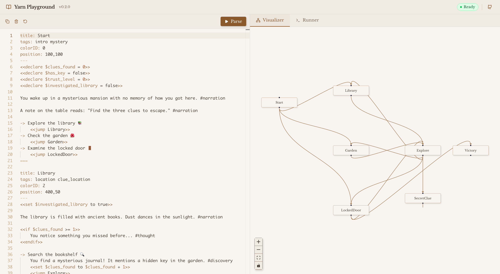
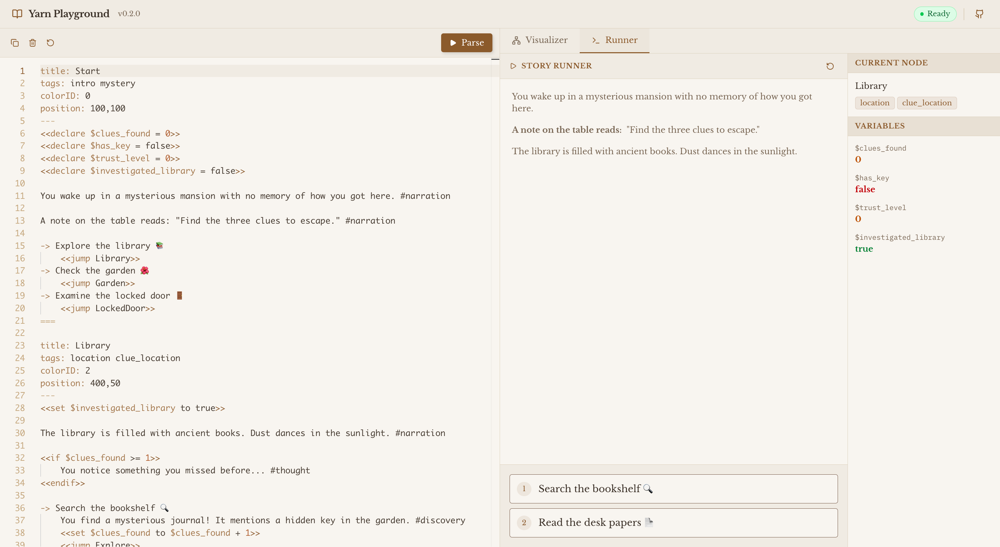

<div align="center">

# 🧶 Yarn Playground

**A browser sandbox for [Yarn Spinner](https://yarnspinner.dev/) — write, parse, and visualize branching dialogue without leaving the tab.**

Powered by the official **Yarn Spinner 3 C# compiler** running in your browser via .NET 10 WebAssembly. No fork, no port — the real thing, just sandboxed.

[**▶ Try it live → yarn.wickend.dev**](https://yarn.wickend.dev)


**Visualizer** — editor on the left, live node graph on the right (click a node to jump to its source).



**Runner** — step through dialogue and watch variables update in real time.



</div>

---

## Why?

I wanted a low-friction way to **prototype Yarn dialogue** — see the node graph, click through choices, and watch variables tick — without spinning up Unity.

So I dropped the official C# compiler into a Blazor WASM bundle, glued it to a React UI, and called it a playground. It's the same parser used in production Yarn games. It just happens to run in your browser.

## What's inside

- 🖋  **Monaco editor** with Yarn syntax highlighting
- 🕸  **Live node graph** (React Flow + Dagre auto-layout) — click a node, jump to its source
- ▶️  **Story runner** with real-time variable inspection
- 🦾  **First-class parsing** via the genuine Yarn Spinner 3 compiler — diagnostics match what Unity gives you
- 📜  Sample story bundled (`cafe-ordering-demo.yarn`) so you can hit Run on first paint

## Try it locally

```bash
pnpm install
pnpm dev
# → http://localhost:5173
```

> Requires `pnpm`, Node 20+, and **.NET 10 SDK** (for the first build of the WASM bundle).

## How it fits together

```
 ┌──────────────────────┐        ┌──────────────────────────────┐
 │  React + Monaco UI   │  ───▶  │  YarnSpinnerJS  (Blazor WASM) │
 │  (this repo)         │  ◀───  │  Yarn Spinner 3 compiler (C#) │
 └──────────────────────┘        └──────────────────────────────┘
            │
            ├─▶  React Flow  →  visual node graph
            └─▶  Story Runner →  step through dialogue + state
```

The C# project lives under `csharp/YarnSpinnerJS/` and builds into a WASM bundle the Vite dev server serves directly.

## Status

Personal playground / weekend project. Stable enough to write dialogue in, but the API surface and graph layout are still moving. PRs and issues welcome — fair warning that I treat this like a sketchbook, not a product.

## Credits

Built on the work of folks who did the hard parts —

- [Yarn Spinner](https://yarnspinner.dev/) by Secret Lab
- [React Flow](https://reactflow.dev/)
- [Monaco Editor](https://microsoft.github.io/monaco-editor/)

## License

[MIT](./LICENSE) © [Wickes1](https://github.com/wickes1) — do whatever, just don't blame me.
